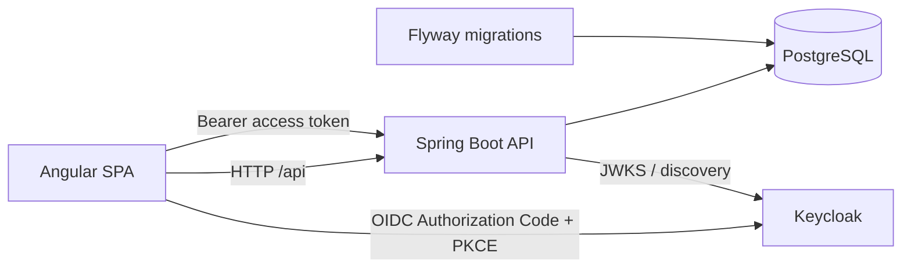

# Arquitetura atual

Este documento descreve o estado encontrado no repositório, não toda a visão futura do produto. A referência para escopo funcional de cada módulo continua sendo sua especificação; resultados de validação são históricos e estão em [validation.md](validation.md). ADRs estão em [decisions/](decisions/).

## Visão geral

O ERP Core é um monólito modular com uma API Spring Boot e uma SPA Angular. PostgreSQL é o banco relacional; Flyway versiona o schema. Keycloak fornece identidade OIDC. Não há serviços distribuídos nem multi-tenancy implementados.

## Backend

- Java 21 e Spring Boot 3.5.16; Maven é o build definido em `apps/api/pom.xml`.
- Pacotes de primeiro nível: `catalog`, `customers`, `inventory`, `sales`, `finance` e `platform` sob `com.erp.core`.
- `catalog` tem `api`, `application` e `domain`; expõe produtos/categorias na API v1 e produtos também em v2. Requisições/respostas são contratos distintos das entidades JPA.
- `customers` contém domínio, persistência e componentes de aplicação para filtros/ordenação. Na revisão desta documentação não há controller REST de clientes; a especificação está em [specs/customers.md](specs/customers.md).
- `platform` contém segurança, identidade, tratamento global de erros e configuração web. `inventory`, `sales` e `finance` têm atualmente apenas estrutura/pacotes de módulo, sem domínio funcional implementado.
- A aplicação usa Spring Security Resource Server stateless. `/actuator/health` é público; as demais rotas negam por padrão. Authorities são derivadas das roles reconhecidas do realm.

## Frontend

- Angular 22.2.3, standalone, TypeScript e npm. A SPA tem shell/rotas, autenticação, páginas de fundação e feature funcional de catálogo em `apps/web/src/app/catalog/`.
- A feature de catálogo mantém serviço de categorias na API v1 e serviço de produtos na v2. Não há feature funcional Angular de clientes, vendas, estoque ou financeiro nesta revisão.
- `keycloak-js` 26.2.5 implementa OIDC no browser. O interceptor adiciona bearer somente à origem/caminho configurados da API; guards controlam navegação, mas não substituem autorização do servidor.
- Os scripts efetivos estão em `apps/web/package.json`; o teste usa o builder de teste do Angular configurado em `angular.json`.

## Persistência e comunicação

- PostgreSQL 17.11 é configurado no Compose local. O schema de negócio é `erp`; o Keycloak usa database separado (`erp_keycloak`) no mesmo serviço PostgreSQL local.
- Flyway é integrado pelo Spring Boot. As migrations presentes na revisão são V1 a V5 em `apps/api/src/main/resources/db/migration`; não inferir que uma versão futura está livre sem inspecionar o diretório.
- Hibernate usa `ddl-auto: validate`, não `update`. Os testes backend exigem `TEST_DATABASE_URL`, `TEST_DATABASE_USERNAME` e `TEST_DATABASE_PASSWORD`; devem apontar para banco dedicado `erp_core_test`. O Compose cria `erp_core`, não o banco de teste. Veja [instruções dos testes PostgreSQL](../apps/api/src/test/resources/README.md).
- A SPA chama a API sob `/api`; operações implementadas usam `/api/v1` e, para produtos, `/api/v2`. O contrato compartilhado está em [api-contract.yaml](api-contract.yaml); clientes ainda não têm endpoints.

## Identidade e autorização

- O realm `erp-core` local é declarado em `infra/keycloak/erp-core-realm.json`; o serviço local usa Keycloak 26.7.3.
- O browser usa cliente público `erp-core-web`, Authorization Code + PKCE S256. A API aceita access token com assinatura, issuer, validade e audience `erp-core-api` verificados.
- Roles conhecidas do realm são mapeadas a `ROLE_*`. A autorização efetiva é aplicada pelo backend por rota/método; controles no Angular são apenas de apresentação/navegação.
- A matriz e os limites documentados estão em [security-model.md](security-model.md). Papéis de módulos ainda não implementados são planejamento, não prova de endpoint existente.

## Infraestrutura e operação

`infra/compose.yaml` inicia PostgreSQL e Keycloak vinculados a loopback. `infra/.env.example` contém padrões locais descartáveis; não usar como credenciais de produção. `scripts/verify.ps1` reúne verificações no ambiente Windows. O fluxo e as versões locais devem ser confirmados no [README da raiz](../README.md) e nos arquivos de configuração, não inferidos de um relatório histórico.

## Evolução planejada

As especificações em `docs/specs/` descrevem trabalhos planejados ou em andamento. A existência de uma especificação não significa que endpoint, tela, migration ou regra correspondente foi implementado. Em particular, o módulo de clientes possui persistência e consultas de domínio, mas o contrato CRUD/API e a feature Angular continuam planejados nesta revisão.
